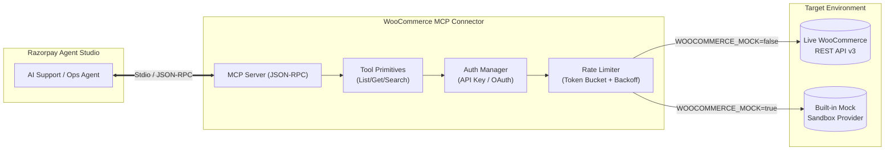

# Razorpay Agent Studio: WooCommerce Private Connector

[]()
[](https://modelcontextprotocol.io)
[](https://www.typescriptlang.org/)
[](https://nodejs.org/)

A production-grade **Model Context Protocol (MCP)** private connector enabling **Razorpay Agent Studio** AI agents to securely query orders, line items, fulfillment details, and real-time inventory from WooCommerce merchant stores.

Built for the **Forward-Deployed Engineer, Agent Studio** evaluation at Razorpay.

---

## 📑 Architecture Overview



---

## ✨ Key Features

1. **Official MCP Tool Specification:** Implements the official `@modelcontextprotocol/sdk` specification with strict Zod schema validation, detailed parameter descriptions, and structured text responses. Compatible with Claude Desktop, Cursor, and Agent Studio runners.
2. **Dual-Mode Operation (Zero-Friction Evaluation):**
   - **Mock Sandbox Mode (Default):** Pre-seeded with 10+ realistic e-commerce orders (processing, completed, on-hold, failed with Razorpay IDs) and inventory records. Evaluators can test every single feature immediately without setting up WordPress or configuring credentials.
   - **Live Store Mode:** Seamlessly connects to any live WooCommerce store using REST API v3 over HTTPS.
3. **Comprehensive Authentication:**
   - **API-Key Auth:** Standard HTTP Basic Auth (`ck_...` / `cs_...`) with automatic fallback to query parameter injection for environments where reverse proxies strip authorization headers.
   - **OAuth 1.0a Onboarding Helper:** Generates secure merchant authorization URLs (`wc-auth/v1/authorize`) with read-only scopes.
   - **Credential Masking:** Prevents leaking credentials in logs, agent outputs, and telemetry.
4. **Resilient Two-Tier Rate Limiting:**
   - **Proactive Throttling:** Token Bucket algorithm controlling requests-per-second (RPS) and burst limits to protect merchant servers from being overwhelmed.
   - **Reactive 429 Handling:** Detects HTTP 429 (Too Many Requests), parses `Retry-After` headers, and performs exponential backoff with full jitter to avoid thundering-herd problems.
5. **Complete Agent Primitives:**
   - Orders: `wc_list_orders`, `wc_get_order`, `wc_search_orders`
   - Catalog & Inventory: `wc_list_products`, `wc_get_product`, `wc_check_inventory`
   - Diagnostics: `wc_verify_connection`

---

## 🚀 Quick Start Guide

### Prerequisites
- Node.js >= 18.0.0 (Tested on Node.js v24)
- npm >= 9.0.0

### 1. Installation
```powershell
npm install
```

### 2. Run Interactive Agent Demo
Simulates 5 real-world Agent Studio scenarios (order tracking, inventory lookup, out-of-stock guardrail, on-hold payment investigation, and simulated 429 recovery):
```powershell
npm run demo
```

### 3. Run Automated Tests (Vitest)
Executes 24 unit and integration tests across auth, primitives, rate limiting, and MCP tools:
```powershell
npm test
```

### 4. Build TypeScript Distribution
```powershell
npm run build
```

### 5. Launch MCP Server (Stdio)
```powershell
npm run mcp
```

---

## 🔌 Connecting to Claude Desktop / Cursor / Agent Studio

To attach this connector to Claude Desktop or any MCP-compatible agent runtime, add the following to your configuration file (e.g., `%APPDATA%\Claude\claude_desktop_config.json` on Windows or `~/Library/Application Support/Claude/claude_desktop_config.json` on macOS):

```json
{
  "mcpServers": {
    "woocommerce-connector": {
      "command": "node",
      "args": ["C:/Users/Yashwanth G R/Desktop/migratenew/dist/index.js", "--mode=mcp"],
      "env": {
        "WOOCOMMERCE_MOCK": "true",
        "WOOCOMMERCE_RATE_LIMIT_RPS": "5",
        "WOOCOMMERCE_RATE_LIMIT_BURST": "10"
      }
    }
  }
}
```

---

## 🛠️ MCP Tool Primitives Specification

| Tool Name | Parameters | Description |
| :--- | :--- | :--- |
| `wc_list_orders` | `page` (int), `per_page` (int), `status` (enum) | Lists orders with pagination and filtering (`processing`, `completed`, `on-hold`, `failed`, `refunded`). |
| `wc_get_order` | `order_id` (int, required) | Retrieves full order details including line items, billing/shipping address, carrier tracking number, and Razorpay transaction IDs. |
| `wc_search_orders` | `query` (string, required), `page` (int), `per_page` (int) | Searches orders by customer email, customer name, order number, or transaction ID. |
| `wc_list_products` | `page` (int), `per_page` (int), `category` (string), `stock_status` (enum) | Lists products in catalog with stock levels, categories, and prices. |
| `wc_get_product` | `product_id` (int, required) | Retrieves full product specifications, SKU, stock count, and regular/sale pricing. |
| `wc_check_inventory` | `sku` (string, optional), `product_id` (int, optional) | Instant stock lookup returning availability status (`instock`, `outofstock`, `onbackorder`) and quantity. |
| `wc_verify_connection` | *None* | Diagnostic health check verifying store connectivity, credentials, and token bucket stats. |

---

## ⚙️ Configuration & Environment Variables

Copy `.env.example` to `.env` to configure live store access:

| Variable | Default | Description |
| :--- | :--- | :--- |
| `WOOCOMMERCE_MOCK` | `true` | When `true`, runs the local sandbox with zero external dependencies. Set to `false` for live stores. |
| `WOOCOMMERCE_URL` | `https://demo-store.example.com` | Base URL of the WooCommerce store (e.g., `https://mystore.com`). |
| `WOOCOMMERCE_CONSUMER_KEY` | `""` | WooCommerce REST API Consumer Key (`ck_...`). |
| `WOOCOMMERCE_CONSUMER_SECRET` | `""` | WooCommerce REST API Consumer Secret (`cs_...`). |
| `WOOCOMMERCE_RATE_LIMIT_RPS` | `5` | Proactive requests per second allowed by the Token Bucket. |
| `WOOCOMMERCE_RATE_LIMIT_BURST` | `10` | Maximum burst capacity in the Token Bucket. |
| `WOOCOMMERCE_MAX_RETRIES` | `3` | Maximum retry attempts for HTTP 429 / 503 errors. |
| `WOOCOMMERCE_RETRY_BASE_DELAY_MS` | `500` | Base delay (ms) for exponential backoff calculations. |
| `WOOCOMMERCE_TIMEOUT_MS` | `10000` | HTTP request timeout duration in milliseconds. |

---

## 🔒 Security & Guardrails

For detailed security boundaries, read-only permissions, and safety policies, see [AGENT_CAPABILITIES.md](file:///c:/Users/Yashwanth%20G%20R/Desktop/migratenew/AGENT_CAPABILITIES.md).

- **Read-Only Operation:** The connector does not expose mutating tools (no order creation, cancellation, or catalog edits) to prevent hallucinated changes.
- **Zero Sensitive Cardholder Data:** The agent never handles raw credit card numbers or banking passwords. It only inspects tokenized transaction references (`pay_...`).
- **Sanitized Logging:** All consumer keys and secrets are automatically masked in diagnostics and logs.

---

## 📌 Assumptions & Limitations

1. **Read-Only Scope:** Mutating operations (such as issuing refunds or modifying stock) are intentionally omitted from this connector's MCP tool spec. Modifying orders should be conducted through a Human-in-the-Loop (HITL) approval process.
2. **WooCommerce REST API v3:** Assumes the store runs WooCommerce 3.5+ with the WP REST API enabled (standard on all modern WooCommerce installations).
3. **Tracking Information Storage:** Tracking numbers and carrier names in WooCommerce are stored in order metadata (e.g. `_tracking_number`, `_shipping_carrier`) typically populated by shipment plugins (Shiprocket, BlueDart, WooCommerce Shipment Tracking). The connector inspects these metadata fields automatically.
4. **Offline Synchronization:** The connector reflects the real-time state of the WooCommerce database. If the merchant uses an external ERP that synchronizes on batch intervals, there may be slight propagation latency from the physical warehouse to the WooCommerce database.
